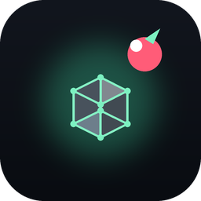

<p align="center">
  
</p>

<h1 align="center">BiteMatica</h1>

<p align="center"><strong>Client-side schematics for Minecraft: Bedrock Edition on Android — as a GlowberryClient <code>.AntEgg</code> mod.</strong></p>

<p align="center">
  <a href="https://github.com/ChimeraAnt-DEV/BiteMatica/actions/workflows/build.yml"></a>
  <a href="https://github.com/ChimeraAnt-DEV/BiteMatica/releases"></a>
  <a href="https://github.com/ChimeraAnt-DEV/BiteMatica/releases"></a>
  <a href="https://github.com/ChimeraAnt-DEV/BiteMatica/blob/main/LICENSE"></a>
  <a href="https://github.com/ChimeraAnt-DEV/BiteMatica/issues"></a>
  <a href="https://github.com/ChimeraAnt-DEV/BiteMatica/stargazers"></a>
</p>

<p align="center">
  
  
  
  
  
</p>

---

## What this is

BiteMatica brings the *Litematica* experience to **Minecraft: Bedrock Edition on Android**, packaged as a native **`.AntEgg`** mod for [GlowberryClient](https://github.com/ChimeraAnt-DEV/GlowberryClient).

Load a schematic, see it drawn over your world, read off exactly how many of which blocks it needs, and export a Bedrock-native structure file when you are done. It is a **client-side viewer and helper** — it never touches a server, never places blocks on its own, and makes no attempt to hide what it is.

If you know Litematica on Java Edition, the mental model is the same: a schematic is a box of blocks, the overlay shows you where each block belongs, and the material list tells you what to gather.

### Why "BiteMatica"?

It is a *bite-sized Litematica for Bedrock* — rebuilt from the ground up for a touchscreen and a gamepad, not ported from a keyboard-and-mouse Java mod.

---

## Features

### Reads every schematic format that matters
| Format | Extension | Where it comes from |
| --- | --- | --- |
| **Litematica** | `.litematic` | Java Edition Litematica / malilib |
| **Sponge / WorldEdit** | `.schem` | WorldEdit, BuildTools, most servers |
| **MCEdit legacy** | `.schematic` | older tools and many Bedrock packs |
| **Bedrock structure** | `.nbt` / `.mcstructure` | the game's own structure blocks |

Detection is by **content first**, not the file extension: BiteMatica decompresses the file, reads its NBT, and inspects the root compound to decide what it is holding. A `.litematic` renamed to `.schem` still opens. A file that is not a schematic fails with a specific reason ("schem is missing a Palette compound"), never with a vague "unsupported file".

### The overlay
- An **isometric block overlay** projected from the schematic's own geometry, so a wall reads as a wall and a roof reads as a roof.
- **Face culling**: only the faces that point toward the camera are meshed, and fully enclosed blocks are skipped — a 3×3×3 cube draws 26 blocks, not 27, because the centre one can never be seen.
- **Three render modes**: translucent **Overlay** (the default), a bounding-box **Skeleton** for placement checks, and **Hidden**.
- **Adjustable opacity** (10–100%) so the build never fights the world behind it.
- **Painter's sort** — far faces are drawn before near ones, so overlapping geometry composites correctly instead of z-fighting.
- A **render-block cap** (default 60,000, up to 250,000) so a mega-build cannot stall your frame rate; when the cap bites, the status line says so instead of silently dropping blocks.

### Material list
The material panel counts how many of each block the schematic needs, sorted by quantity and grouped by **base block id**. You care that you need 340 stone, not that 120 of them are `axis=y`. It shows the top 16 and a "+N more" line.

### Export to Bedrock
Press **S** (the *Export* button) and the loaded schematic is written to the mod's `data/exports/` folder as a **`.mcstructure`** — a file the game's own structure block, or any Bedrock tool, can read. This is the round-trip half of the `.nbt` reader, and it is covered by a test that exports and re-imports a build and checks the block counts match.

### Built for touch and for a controller
- **Touch**: a six-by-two toolbar of 40 px buttons with generous hit boxes, each tap consumed so it never falls through to the world. Every button has a one-letter glyph and a live status line under the bar.
- **Controller**: a full focus-based navigation model. The d-pad moves focus across the same grid the touch buttons use, **A** activates the focused action, **B** releases focus, and the shoulder buttons are a direct shortcut to rotate left/right. The focus hint is drawn on screen so you always know what A will do.
- Touch and controller share **one** definition of the toolbar layout, so a button a controller can focus is always a button a finger can tap.

### The toolbar

| Glyph | Action | What it does |
| --- | --- | --- |
| `<` `>` | Previous / next file | Cycles the schematics in the mod's `schematics/` folder |
| `M` | Render mode | Overlay → Skeleton → Hidden |
| `L` | Material list | Shows or hides the block-count panel |
| `Q` `E` | Rotate left / right | Turns the view 15° (also **L1** / **R1**) |
| `+` `-` | Zoom in / out | Scales the projection |
| `^` `v` | Nudge up / down | Lifts or drops the build |
| `G` | Ghost placement | Outlines where the build would land |
| `S` | Export | Writes a `.mcstructure` |
| `R` | Reload | Re-scans the schematics folder |

### Mod Menu integration
BiteMatica registers a native Mod Menu module with a master toggle and live config: **Render Mode**, **Opacity**, **Material List**, and **Ghost Placement**. Turning the module off clears the overlay instead of leaving stale geometry on screen.

---

## Install

BiteMatica is a **GlowberryClient `.AntEgg` mod**. It needs [GlowberryClient](https://github.com/ChimeraAnt-DEV/GlowberryClient) to run.

1. Download the latest `BiteMatica-<version>.antegg` from the [Releases page](https://github.com/ChimeraAnt-DEV/BiteMatica/releases).
2. Open GlowberryClient and import the `.antegg` (Mods tab → import, or open the file with the launcher).
3. Enable **BiteMatica** in the Mod Menu.
4. Put your schematics in the mod's `schematics/` folder (created on first load; the path is the mod's own directory under `AntEggs/bitematica/schematics/`). A demo hut ships in the package so you see something immediately.
5. Press **R** in the toolbar after adding files.

> **Package layout** — an `.AntEgg` is a ZIP with the `.antegg` extension. A native mod needs **both** manifests: `egg.json` is what `.AntEgg` validation reads, and `manifest.json` is what the preloader reads at the extracted mod root — it refuses to load a library unless that manifest is present, is `type: "preload-native"`, and names an entry that exists inside the package.
> ```
> BiteMatica-1.0.1.antegg
> ├── egg.json                     .AntEgg manifest (name/version/author/type/entry_point)
> ├── manifest.json                preloader manifest (type: preload-native, entry, icon)
> ├── bin/libbitematica.so         the arm64-v8a native mod
> ├── icon.png                     mod icon shown by the launcher
> ├── config/config.json           default settings
> ├── config/config.schema.json    schema for the launcher's config editor
> └── schematics/demo_house.litematic
> ```

---

## Requirements

- **GlowberryClient** installed and working.
- **Android 9.0 (API 28)** or newer, **arm64-v8a**. (This mod is arm64-only, matching the launcher's own build.)
- Minecraft: Bedrock Edition, any version GlowberryClient supports.

---

## Build from source

The native mod is C++20, built with the Android NDK, and links the [preloader-android](https://github.com/ChimeraAnt-DEV/preloader-android) SDK (the same SDK GlowberryClient's other native mods use).

### Prerequisites
- An Android NDK (r25+; r28c is what CI uses).
- CMake 3.22+ and Ninja.
- Python 3 (for fixture generation, packaging, and the icon).
- Git.

### One command
```bash
./build.sh --test          # run the host tests, then build and package
```
On Windows:
```powershell
.\build.ps1 -Test
```

Output:
```
dist/BiteMatica-1.0.0.antegg
```

`build.sh` discovers the NDK from `ANDROID_NDK_HOME` / `ANDROID_NDK_ROOT` / `ANDROID_HOME`, or takes `--ndk <path>`. If the preloader SDK is not already under `third_party/preloader-android`, it clones the SDK's `main` branch automatically, so the build has no hidden machine-local dependency. Set `PRELOADER_REF` to pin a branch or commit.

### The host test suite
The format readers, palette unpacking, the mesh projector, the toolbar geometry, the controller grid, the config round-trip and the structure export are all pure C++ with **no Android dependency**, so they are built and run on the host:

```bash
cmake -S . -B build/host -DCMAKE_BUILD_TYPE=Release
cmake --build build/host --target bitematica_tests
./build/host/bitematica_tests
```

The suite reads **real, generated schematic files** (gzip NBT, packed long arrays and all) through the production readers — not mocks. `test/make_fixtures.py` writes them, and its encoders are shared with the demo-schematic generator, so there is one definition of each wire format.

---

## Configuration

Settings live in `config/config.json` inside the installed mod. The launcher's config editor reads `config/config.schema.json`, and the in-game Mod Menu can change the common ones live.

```json
{
  "version": 1,
  "enabled": true,
  "renderMode": 0,
  "opacity": 60,
  "showMaterialList": true,
  "showToolbar": true,
  "ghostPlacement": false,
  "onlyExposed": true,
  "maxRenderBlocks": 60000
}
```

| Key | Meaning |
| --- | --- |
| `renderMode` | `0` overlay · `1` skeleton · `2` hidden |
| `opacity` | overlay alpha in percent (10–100) |
| `onlyExposed` | skip fully enclosed blocks when meshing |
| `maxRenderBlocks` | per-frame meshing cap (500–250000) |
| `toolbarX`/`toolbarY` | toolbar anchor in HUD pixels |
| `materialX`/`materialY` | material-panel anchor in HUD pixels |

A hand-edited value that is out of range is **clamped** on load, so a typo cannot take the overlay off screen.

---

## How it works

```
bitematica_core   (host-testable, no Android)
  nbt/       NbtReader, NbtWriter        gzip / zlib / raw NBT
  format/    Litematica, Sponge, MCEdit, Bedrock structure readers, StructureWriter
  core/      Schematic, BlockPalette, MaterialList
  render/    ViewCamera, MeshBuilder, HudOverlay
  mod/       Config, JsonConfig, SchematicLibrary, ControllerNavigator
        |
        |  UiCommand -> pl::modmenu::DrawCommand
        v
  mod/BiteMaticaMod.cpp   preloader glue: Mod Menu, input, overlay submit
```

A schematic is normalized into one shape — a palette plus one palette index per block — so the renderer and the material list never know or care which dialect it came from. The overlay is submitted as flat filled-triangle draw commands, which is the only 3D-ish primitive the launcher HUD exposes; the isometric projection happens here in the mod, in pure arithmetic that the host tests exercise directly.

### Honest engineering notes
- **No per-frame callback is invented.** The public SDK has none, so the overlay's command list is re-submitted whenever it can change (load, toggle, input) and stays static in between — correct for a view a player only moves on purpose.
- **Fail-closed everywhere.** A missing file, a malformed manifest, a truncated archive, an unreadable config: each becomes a named, user-visible reason in the status line, never a crash and never a guessed render.
- **The demo that ships is real.** The bundled hut is written by the same encoders the tests use, and it is loaded back through the production reader before packaging.

---

## Attribution

BiteMatica is inspired by **[Litematica](https://github.com/maruohon/litematica)** by **maruohon** and its **[malilib](https://github.com/maruohon/malilib)** library, both client-side mods for Minecraft **Java Edition**. This project is a **from-scratch reimplementation for Bedrock Edition on Android**: it uses no Litematica or malilib code, and it does not run Java Edition mods. The concept — load a schematic, overlay it, count the materials — is theirs; the Bedrock/Android implementation is this repository's.

BiteMatica is an independent third-party mod and is not affiliated with Mojang, Microsoft, Litematica, or GlowberryClient's authors beyond depending on the launcher's mod format.

---

## License

Licensed under the **Apache License 2.0** — see [LICENSE](LICENSE).